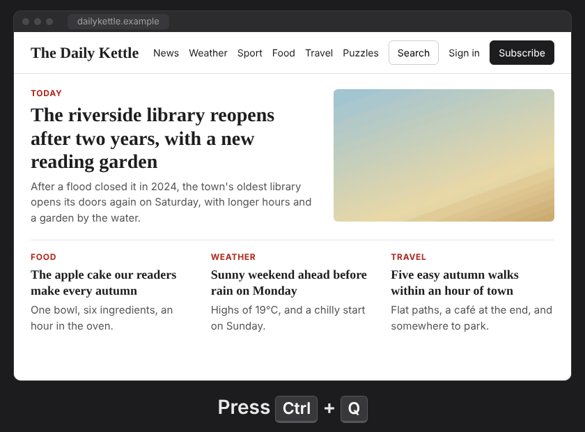

Pressing <kbd>Ctrl</kbd>+<kbd>Q</kbd> will focus the control/field that the ranker assumes you want, based on the current page, focused elements, etc.

**[Add to Chrome](https://chromewebstore.google.com/detail/jab/dfnikmnfgjnbmhfnpeigignlgpkggbji)**

> **Mom can we have `tab`?**

> We have `tab` at home.

The ranker is lean: Just 27KB, LightGBM (2016) trees running in-browser CPU-only in about 2ms. No network requests, nothing leaves the browser ([privacy](PRIVACY.md)).

- The first <kbd>Ctrl</kbd>+<kbd>Q</kbd> will focus the control, as well as highlight 3 other picks with small numbered badges.
- Tap <kbd>Ctrl</kbd>+<kbd>Q</kbd> again: the next of the four.
- Hold <kbd>Ctrl</kbd>+<kbd>Q</kbd> and press <kbd>1</kbd> to <kbd>4</kbd>: Straight to that one.

Anything else you do (typing, clicking, another key) ends it, and the next <kbd>Ctrl</kbd>+<kbd>Q</kbd> will be a new session.

Open source (MIT): [github.com/netanel-haber/jab](https://github.com/netanel-haber/jab)

MIT License

Copyright (c) 2026 Netanel Haber

Permission is hereby granted, free of charge, to any person obtaining a copy
of this software and associated documentation files (the "Software"), to deal
in the Software without restriction, including without limitation the rights
to use, copy, modify, merge, publish, distribute, sublicense, and/or sell
copies of the Software, and to permit persons to whom the Software is
furnished to do so, subject to the following conditions:

The above copyright notice and this permission notice shall be included in all
copies or substantial portions of the Software.

THE SOFTWARE IS PROVIDED "AS IS", WITHOUT WARRANTY OF ANY KIND, EXPRESS OR
IMPLIED, INCLUDING BUT NOT LIMITED TO THE WARRANTIES OF MERCHANTABILITY,
FITNESS FOR A PARTICULAR PURPOSE AND NONINFRINGEMENT. IN NO EVENT SHALL THE
AUTHORS OR COPYRIGHT HOLDERS BE LIABLE FOR ANY CLAIM, DAMAGES OR OTHER
LIABILITY, WHETHER IN AN ACTION OF CONTRACT, TORT OR OTHERWISE, ARISING FROM,
OUT OF OR IN CONNECTION WITH THE SOFTWARE OR THE USE OR OTHER DEALINGS IN THE
SOFTWARE.

